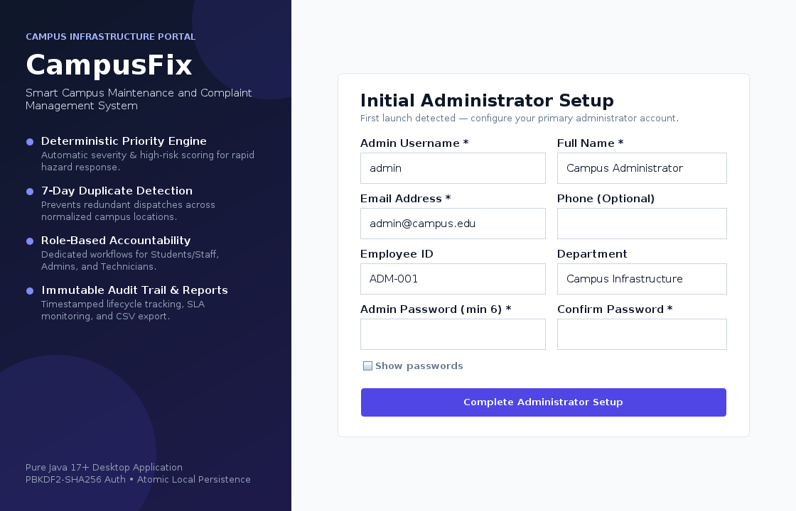
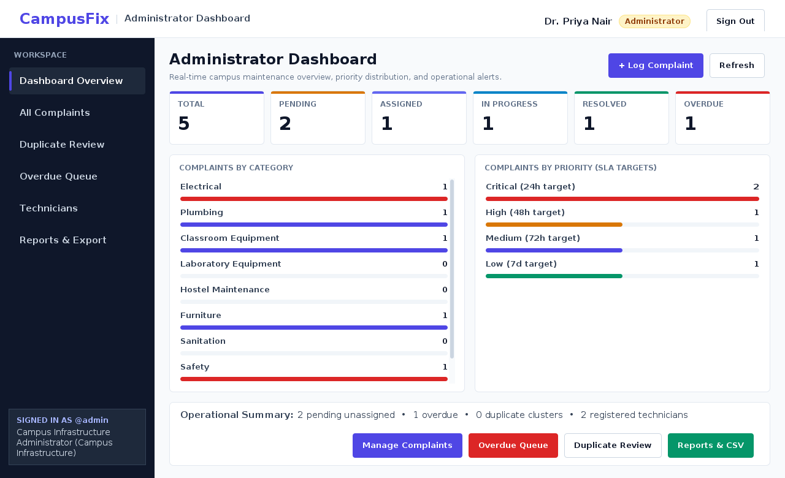
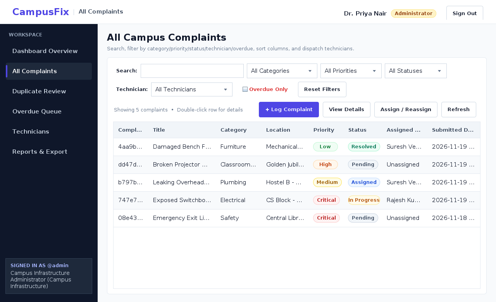
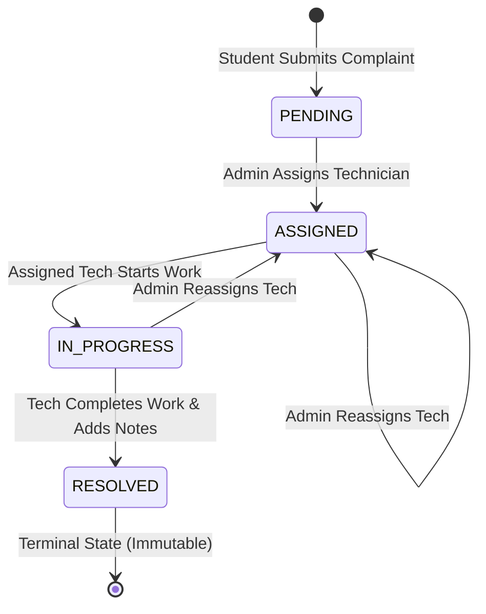

# CampusFix – Smart Campus Maintenance and Complaint Management System

**Department of Computer Science and Engineering**  
**Course:** Object-Oriented Programming with Java (Experiential Learning Project)  
**Academic Level:** 3rd Semester B.E. / B.Tech  
**Target Environment:** OpenJDK 17+ (Java Standard Library Exclusively)

[](https://github.com/prabalpratapsinghmer/java-project/releases/latest)
[-4F46E5.svg)](https://github.com/prabalpratapsinghmer/java-project/releases/download/v1.0.0/CampusFix-1.0.0-Portable.zip)
[](https://github.com/prabalpratapsinghmer/java-project/releases/download/v1.0.0/CampusFix-1.0.0.jar)
[](https://github.com/prabalpratapsinghmer/java-project/releases/download/v1.0.0/campusfix_1.0.0_amd64.deb)
[](https://prabalpratapsinghmer.github.io/java-project/)
[](understand.md)

**Live Documentation Website:** [https://prabalpratapsinghmer.github.io/java-project/](https://prabalpratapsinghmer.github.io/java-project/)  
**All Downloads & Release Notes:** [https://github.com/prabalpratapsinghmer/java-project/releases/latest](https://github.com/prabalpratapsinghmer/java-project/releases/latest)  
**Comprehensive System & Architecture Manual:** [understand.md](understand.md)

---

## Download & Run CampusFix (Windows, macOS & Linux)

Choose the package that matches your operating system from [**GitHub Release v1.0.0**](https://github.com/prabalpratapsinghmer/java-project/releases/latest):

| Platform | Recommended Download | How to Launch |
|---|---|---|
| **Windows / macOS / Linux (All OS)** | [**`CampusFix-1.0.0-Portable.zip`**](https://github.com/prabalpratapsinghmer/java-project/releases/download/v1.0.0/CampusFix-1.0.0-Portable.zip) | Unzip and double-click `Launch-Windows.bat` (Windows), `Launch-macOS.command` (macOS), or `./Launch-Linux.sh` (Linux). Requires Java 17+. |
| **Any OS (Single File)** | [**`CampusFix-1.0.0.jar`**](https://github.com/prabalpratapsinghmer/java-project/releases/download/v1.0.0/CampusFix-1.0.0.jar) | Run `java -jar CampusFix-1.0.0.jar` (Windows, macOS, or Linux with Java 17+). |
| **Debian / Ubuntu / Kali Linux** | [**`campusfix_1.0.0_amd64.deb`**](https://github.com/prabalpratapsinghmer/java-project/releases/download/v1.0.0/campusfix_1.0.0_amd64.deb) | Install via `sudo apt install ./campusfix_1.0.0_amd64.deb`, then launch **CampusFix** from your Applications menu (bundles its own Java runtime). |

> **Why is there no Android `.apk`?** CampusFix is built strictly in **Java Swing / AWT** per academic specification (`idea.md`), which is a desktop UI framework for Windows, macOS, and Linux rather than Android mobile devices.

### Interface Previews
| Initial Admin Setup | Administrator Dashboard | All Complaints & Pill Badges |
|---|---|---|
|  |  |  |

---

## 1. Project Title
**CampusFix – Smart Campus Maintenance and Complaint Management System**

A robust, enterprise-inspired Java desktop application designed to streamline campus infrastructure maintenance, eliminate duplicate requests, automate priority scoring, track multi-stage issue resolution, and provide comprehensive administrative oversight without third-party runtime dependencies.

---

## 2. Project Overview
Educational institutions maintain complex, distributed infrastructure across academic blocks, laboratories, lecture halls, administrative offices, and student hostels. Infrastructure breakdowns (e.g., electrical sparks, leaking pipes, malfunctioning projectors, jammed doors) directly disrupt teaching and student safety.

CampusFix provides a centralized, role-based desktop solution implemented purely in standard Java (Java Swing, AWT, Collections Framework, NIO File I/O, and PBKDF2 cryptography). It enforces end-to-end accountability through an immutable audit trail, a transparent rule-based priority engine, and atomic local file persistence.

---

## 3. Real-World Problem Statement
Historically, educational campuses manage maintenance requests through manual paper logbooks, verbal notices to peons, or uncoordinated WhatsApp/email threads. This ad-hoc approach suffers from critical deficiencies:
1. **Lack of Visibility:** Students and faculty have no visibility into whether their complaint was received, assigned, or scheduled.
2. **Delayed Response to Hazards:** Urgent safety hazards (such as electrical short-circuits or ceiling leaks) are buried in logbooks alongside minor cosmetic issues.
3. **Duplicate Work Orders:** Multiple occupants of a classroom or hostel wing report the exact same malfunction, resulting in redundant technician dispatches.
4. **No Accountability or Metrics:** Maintenance departments lack empirical metrics regarding technician workloads, recurring equipment failures, or overdue response targets.

CampusFix solves these challenges by providing automated categorization, deterministic priority calculation, duplicate detection, and granular lifecycle tracking.

---

## 4. Project Objectives
1. **Student Self-Service Portal:** Enable students and staff to register complaints with campus location, category, severity, and detailed descriptions.
2. **Deterministic Priority Engine:** Implement an explainable, rule-based algorithm that elevates urgent infrastructure and safety risks without arbitrary heuristics.
3. **Intelligent Duplicate Warning:** Detect existing unresolved complaints for the same category and campus location submitted within a 7-day rolling window.
4. **Role-Based Task Assignment:** Provide administrators with real-time technician workload views to facilitate balanced, informed work order assignments.
5. **Enforced Status Lifecycle:** Guarantee a strict state workflow (`PENDING` → `ASSIGNED` → `IN_PROGRESS` → `RESOLVED`) backed by an immutable audit trail.
6. **Overdue SLA Tracking:** Detect unresolved complaints that exceed defined response targets (24h to 7 days based on priority).
7. **Empirical Reporting & CSV Export:** Generate dynamic dashboard summaries and formula-injection-safe CSV reports using RFC-4180 standards.
8. **Demonstrate Core OOP Rigor:** Showcase concrete implementations of Encapsulation, Inheritance, Polymorphism, Abstraction, Interfaces, Generics, and Custom Exception Handling in Java.

---

## 5. Features
- **Modern Design Token UI:** Custom Linear/Tailwind-inspired dark slate palette (`#0F172A`, `#4F46E5`), anti-aliased rounded cards, colored pill badges, and custom table renderers.
- **Zero External Dependencies:** Built 100% with the standard JDK; no Maven/Gradle runtime plugins, no Spring Boot, no external database engines, and no web scripts.
- **PBKDF2 Cryptographic Security:** Passwords hashed with `PBKDF2WithHmacSHA256` using 16-byte cryptographically secure random salts and 65,536 iterations.
- **Atomic File Persistence:** Data stored in organized `java.util.Properties` files with staged `.tmp` writes and atomic file system swaps to prevent data loss.
- **Corrupted Record Quarantine:** Malformed records are safely isolated to `.corrupt` backups while the system continues serving valid records uninterrupted.
- **Formula Injection Defense:** CSV exports prepend single quotes (`'`) to cells starting with `=`, `+`, `-`, or `@` to prevent spreadsheet code execution.

---

## 6. Technology Stack
| Layer | Technology | Purpose |
|---|---|---|
| **Programming Language** | Java 17+ (LTS) / Java 21 / Java 25 | Core object-oriented language |
| **User Interface** | Java Swing & Java AWT | Desktop GUI with custom design tokens |
| **Persistence** | `java.util.Properties` & `java.nio.file` | Atomic local file storage |
| **Security** | `javax.crypto` & `java.security` | PBKDF2 password hashing & salts |
| **Collections** | Java Collections Framework | In-memory query filtering and aggregation |
| **Time API** | `java.time` (Instant, Duration) | Precision timestamps and SLA tracking |
| **Testing** | Standalone Java Test Harness | 30 automated unit and integration tests |

---

## 7. System Architecture
CampusFix is structured following clean architectural separation of concerns:
```
┌───────────────────────────────────────────────────────────────┐
│                     Presentation Layer                        │
│   (LoginFrame, MainFrame, Student / Admin / Tech Panels)      │
│   (UITheme, PillBadge, StatCard, ModernButton, ModernTable)   │
└───────────────────────────────┬───────────────────────────────┘
                                │ Calls Service Interfaces
┌───────────────────────────────▼───────────────────────────────┐
│                    Business Service Layer                     │
│  - AuthenticationService     - PriorityService                │
│  - ComplaintService          - DuplicateDetectionService      │
│  - AssignmentService         - ReportService                  │
└───────────────────────────────┬───────────────────────────────┘
                                │ Reads / Writes Entities
┌───────────────────────────────▼───────────────────────────────┐
│                     Domain Entity Models                      │
│  - User (StudentUser, AdminUser, TechnicianUser)              │
│  - Complaint, ComplaintHistoryEntry                           │
│  - Enums (Role, Category, Severity, Priority, Status)         │
└───────────────────────────────┬───────────────────────────────┘
                                │ Persists / Loads Records
┌───────────────────────────────▼───────────────────────────────┐
│                    Data Persistence Layer                     │
│  - Repository<T, ID>, UserRepository, ComplaintRepository     │
│  - FileUserRepository, FileComplaintRepository                │
│  - FileStorageUtil, PasswordUtil, ValidationUtil, CsvExport   │
└───────────────────────────────┬───────────────────────────────┘
                                │ File I/O (Atomic Move)
┌───────────────────────────────▼───────────────────────────────┐
│                       Local File System                       │
│    data/users/*.properties     data/complaints/*.properties   │
└───────────────────────────────────────────────────────────────┘
```

---

## 8. Java OOP Concepts Demonstrated
| OOP Principle | Implementing Class / Interface | Concrete Code Demonstration |
|---|---|---|
| **Encapsulation** | `Complaint.java`, `User.java` | Private fields, immutable audit history (`Collections.unmodifiableList`), validation in mutators. |
| **Inheritance** | `User.java` → `StudentUser`, `AdminUser`, `TechnicianUser` | Shared identity and credential fields in base class extended by role-specific attributes (`specialization`, `employeeId`, `studentIdNumber`). |
| **Polymorphism** | `User.java` abstract methods | `canManageTechnicians()`, `canAssignComplaints()`, and `canUpdateStatus()` exhibit role-specific behavior without type-casting. |
| **Abstraction** | `User.java`, `Repository<T, ID>` | Abstract definitions of contracts without exposing internal file storage details. |
| **Interfaces** | `UserRepository.java`, `ComplaintRepository.java` | Decouples business services (`ComplaintService`, `AssignmentService`) from file system operations. |
| **Composition** | `ComplaintService.java` | Composed of `ComplaintRepository`, `PriorityService`, `DuplicateDetectionService`, and `AssignmentService`. |
| **Generics** | `Repository<T, ID>`, `Optional<T>`, `List<T>` | Type-safe persistence and querying without raw types. |
| **Exception Handling** | `CampusFixException.java` hierarchy | Custom unchecked domain exceptions (`ValidationException`, `AuthenticationException`, `UnauthorizedException`, `StorageException`). |

---

## 9. Package Structure
```
src/edu/nie/campusfix/
├── Main.java                          # Application entry point & DI wiring
├── enums/
│   ├── AuditActionType.java           # Complaint lifecycle action types
│   ├── Category.java                  # Infrastructure domains (isHighRisk())
│   ├── ComplaintStatus.java           # State machine lifecycle enums
│   ├── Priority.java                  # Priority levels with SLA target hours
│   ├── Role.java                      # STUDENT, ADMIN, TECHNICIAN
│   └── Severity.java                  # Base severity scores (1, 2, 3)
├── exception/
│   ├── AuthenticationException.java   # Invalid login / inactive account errors
│   ├── CampusFixException.java        # Base unchecked application exception
│   ├── ResourceNotFoundException.java # Missing user/complaint errors
│   ├── StorageException.java          # File I/O, traversal, & overwrite errors
│   ├── UnauthorizedException.java     # Service-layer RBAC enforcement errors
│   └── ValidationException.java       # Input validation & transition errors
├── model/
│   ├── AdminUser.java                 # Administrator entity
│   ├── Complaint.java                 # Complaint aggregate with audit history
│   ├── ComplaintHistoryEntry.java     # Immutable audit trail entry
│   ├── StudentUser.java               # Student / Staff reporter entity
│   ├── TechnicianUser.java            # Maintenance specialist entity
│   └── User.java                      # Abstract base user class
├── repository/
│   ├── ComplaintRepository.java       # Interface for complaint queries
│   ├── FileComplaintRepository.java   # Atomic file persistence for complaints
│   ├── FileUserRepository.java        # Atomic file persistence for users
│   ├── Repository.java                # Generic repository interface
│   └── UserRepository.java            # Interface for user queries
├── service/
│   ├── AssignmentService.java         # Work order assignment & RBAC enforcement
│   ├── AuthenticationService.java     # User login, registration, & initial admin setup
│   ├── ComplaintService.java          # Lifecycle orchestration, search, & filter
│   ├── DuplicateDetectionService.java # 7-day location/category duplicate matching
│   ├── PriorityService.java           # Deterministic priority engine
│   └── ReportService.java             # Analytics aggregation & CSV export
├── ui/
│   ├── AdminDashboardPanel.java       # 6-view admin workspace (Dashboard, All, Duplicates, Overdue, Technicians, Reports)
│   ├── LoginFrame.java                # Split-panel Sign In, Registration, & Initial Admin Setup
│   ├── MainFrame.java                 # Main application window with functional dark-slate sidebar
│   ├── StudentDashboardPanel.java     # Student dashboard overview & My Complaints tracker
│   ├── TechnicianDashboardPanel.java  # Technician overview & assigned tasks queue
│   ├── component/
│   │   ├── ModernButton.java          # Rounded interactive button with active sidebar indicator
│   │   ├── ModernTable.java           # Styled sortable JTable with direct-painted pill badge renderers
│   │   ├── PillBadge.java             # Rounded semantic status/priority/overdue/role badge
│   │   └── StatCard.java              # Rounded KPI metric card with colored accent bar
│   ├── dialog/
│   │   ├── AssignTechnicianDialog.java# ID-accurate workload & specialization-matched assignment dialog
│   │   ├── ComplaintDetailDialog.java # 4-step lifecycle stepper, priority rule, & audit timeline
│   │   ├── NewComplaintDialog.java    # Validated submission form with live priority & duplicate checks
│   │   └── ResolveComplaintDialog.java# Mandatory resolution notes dialog with character counter
│   └── theme/
│       └── UITheme.java               # Cross-platform light design tokens, scrollbars, & chart helpers
├── util/
│   ├── CsvExportUtil.java             # Atomic RFC-4180 UTF-8 CSV export with formula injection defense
│   ├── FileStorageUtil.java           # Atomic file persistence, safe path resolution, & quarantine
│   ├── PasswordUtil.java              # PBKDF2WithHmacSHA256 password hashing & memory wiping
│   └── ValidationUtil.java            # Domain input, ID, and length boundary validators
└── tests/
    ├── TestRunner.java                # Standalone test suite executing 30 isolated test cases
    └── VerificationProof.java         # Offscreen Swing visual verification & screenshot renderer
```

---

## 10. Installation Instructions
### Prerequisites
- Operating System: Linux (Debian, Ubuntu, Kali, Fedora), macOS, or Windows 10/11.
- Java Development Kit: OpenJDK 17 or higher (tested on OpenJDK 21 LTS).

Check Java installation:
```bash
javac -version
java -version
```

---

## 11. Compilation Instructions
### Linux / macOS
Execute the provided build script:
```bash
chmod +x compile.sh run.sh
./compile.sh
```
Or run the manual compilation command:
```bash
mkdir -p out
javac -encoding UTF-8 -d out $(find src -name "*.java")
```

### Windows (Command Prompt / PowerShell)
```cmd
mkdir out
dir /s /b src\*.java > sources.txt
javac -encoding UTF-8 -d out @sources.txt
del sources.txt
```

---

## 12. Execution Instructions
### Launching the Graphical Application
#### Linux / macOS
```bash
./run.sh
# or directly:
java -cp out edu.nie.campusfix.Main
```

#### Windows
```cmd
java -cp out edu.nie.campusfix.Main
```

### Launching in Headless / CLI Verification Mode
For headless environments or CI pipelines without an active X11 display:
```bash
java -cp out edu.nie.campusfix.Main --headless
```

---

## 13. User Roles & Permissions
```
┌────────────────────────┬─────────────┬─────────────┬────────────────┐
│ Action                 │ Student     │ Technician  │ Administrator  │
├────────────────────────┼─────────────┼─────────────┼────────────────┤
│ Submit Complaint       │   YES       │   NO        │   YES          │
│ View Own Complaints    │   YES       │   NO        │   YES          │
│ View All Complaints    │   NO        │   NO        │   YES          │
│ View Assigned Tasks    │   NO        │   YES       │   YES          │
│ Assign / Reassign Tech │   NO        │   NO        │   YES          │
│ Start Work Order       │   NO        │   YES (own) │   YES          │
│ Mark Resolved & Notes  │   NO        │   YES (own) │   YES          │
│ Register Technicians   │   NO        │   NO        │   YES          │
│ View Analytics & CSV   │   NO        │   NO        │   YES          │
└────────────────────────┴─────────────┴─────────────┴────────────────┘
```

---

## 14. Complete Complaint Workflow


1. **Submission:** A student enters title, category, location, severity, and description. The system executes duplicate detection, computes deterministic priority, marks status `PENDING`, and writes the `CREATED` audit entry.
2. **Assignment:** An administrator opens the complaint, reviews technician workloads, assigns an active technician with an optional note. Status transitions to `ASSIGNED`.
3. **Commencement:** The assigned technician views their queue, selects the complaint, and clicks "Start Work". Status transitions to `IN_PROGRESS`.
4. **Resolution:** After completing maintenance, the technician clicks "Mark Resolved", enters resolution details (minimum 5 characters), and submits. Status transitions to `RESOLVED` with recorded completion timestamp.

---

## 15. Priority Calculation Rules
The priority engine operates on a strictly deterministic formula without non-transparent heuristics:
$$\text{Base Score} = \begin{cases} 1 & \text{Severity} = \text{LOW} \\ 2 & \text{Severity} = \text{MEDIUM} \\ 3 & \text{Severity} = \text{HIGH} \end{cases}$$

$$\text{Category Bonus} = \begin{cases} +1 & \text{Category} \in \{\text{ELECTRICAL}, \text{SAFETY}\} \\ 0 & \text{Otherwise} \end{cases}$$

$$\text{Final Score} = \min(4, \max(1, \text{Base Score} + \text{Category Bonus}))$$

| Final Score | Calculated Priority | Demonstrative Response Target | Example Scenario |
|---|---|---|---|
| **1** | `LOW` | 7 Days (168 hours) | Minor scratch on classroom desk (`LOW` + `FURNITURE`) |
| **2** | `MEDIUM` | 72 Hours | Leaking tap in second-floor washroom (`MEDIUM` + `PLUMBING`) |
| **3** | `HIGH` | 48 Hours | Faulty projector in seminar hall (`HIGH` + `CLASSROOM_EQUIPMENT`) |
| **3** | `HIGH` | 48 Hours | Slippery stairway puddle (`MEDIUM` + `SAFETY` bonus) |
| **4** | `CRITICAL` | 24 Hours | Sparking breaker box (`HIGH` + `ELECTRICAL` bonus) |

> **Note:** The response targets above are **project-defined demonstrative targets** used for overdue tracking and reporting, not official college regulations.

---

## 16. Data Storage Mechanism
CampusFix uses local, zero-dependency file persistence:
- **Directory Structure:**
  - `data/users/<userId>.properties`: User identity, password hash, role, and profile fields.
  - `data/complaints/<complaintId>.properties`: Complaint metadata and serialized audit history.
  - `reports/complaints_summary.csv`: Exported RFC-4180 analytics reports.
- **Atomic File Swapping:** To prevent partial writes upon power failure or system termination, all writes are staged in a `.tmp.<nanoTime>` file in the same directory, followed by `Files.move(..., ATOMIC_MOVE, REPLACE_EXISTING)`.
- **Quarantine Engine:** Corrupted properties files are isolated by renaming to `<filename>.corrupt.<timestamp>`, ensuring system startup never halts.

---

## 17. Security Limitations
1. **Local Machine Scope:** Storage is local to the host machine. Multi-device concurrent synchronization requires external database engines (intentionally prohibited by project academic constraints).
2. **File Permissions:** Protection against unauthorized file manipulation relies on host operating system file permissions.
3. **PBKDF2 Iterations:** 65,536 iterations provide robust cryptographic defense against brute-force attacks on modern hardware.

---

## 18. Testing Instructions
CampusFix includes an automated test runner (`TestRunner.java`) executing 30 isolated verification tests.

Run the test suite:
```bash
./compile.sh
java -cp out edu.nie.campusfix.tests.TestRunner
```

Expected output:
```
==================================================
Running CampusFix Test Suite (30 Tests)
==================================================
[PASS] Test 01: Initial administrator setup works.
[PASS] Test 02: Student account registration works.
[PASS] Test 03: Invalid registration input is rejected.
[PASS] Test 04: Correct login credentials are accepted.
[PASS] Test 05: Incorrect credentials are rejected.
[PASS] Test 06: Student complaint creation works.
[PASS] Test 07: Unique complaint IDs are generated.
[PASS] Test 08: Priority calculation is correct.
[PASS] Test 09: Duplicate complaint warnings are generated correctly.
[PASS] Test 10: Different locations do not cause false duplicate matches.
[PASS] Test 11: Administrator can assign technicians.
[PASS] Test 12: Student cannot assign technicians.
[PASS] Test 13: Technician can view assigned complaints.
[PASS] Test 14: Technician cannot modify unrelated complaints.
[PASS] Test 15: Valid status transitions succeed.
[PASS] Test 16: Invalid status transitions fail safely.
[PASS] Test 17: Resolution notes are saved.
[PASS] Test 18: Complaint history is recorded correctly.
[PASS] Test 19: Overdue classification is correct.
[PASS] Test 20: Dashboard totals are calculated correctly.
[PASS] Test 21: Complaint searches and filters work.
[PASS] Test 22: CSV report export works.
[PASS] Test 23: Application data survives restart/reload.
[PASS] Test 24: Corrupted data is reported safely.
[PASS] Test 25: Application handles an empty complaint database.
[PASS] Test 26: Administrator privileges cannot be obtained through public registration.
[PASS] Test 27: All priority combinations produce the expected result.
[PASS] Test 28: User and complaint records cannot be accidentally overwritten.
[PASS] Test 29: All generated Java classes compile successfully.
[PASS] Test 30: A complete complaint workflow can be executed from creation to resolution.
==================================================
RESULTS: 30 / 30 Passed (0 Failed)
==================================================
```

---

## 19. Sample Demonstration Scenario
1. **Initial Setup:** Launch the application (`./run.sh`). The first-launch screen displays **"Initial Administrator Setup"**. Enter username `admin`, Full Name `Dr. Priya Nair`, Email `admin@nie.ac.in`, Employee ID `ADM-001`, and a secure password (with confirmation).
2. **Register Technician:** On the Admin sidebar, click **"Technicians"** → **"+ Register Technician"**. Enter username `tech_rajesh`, Full Name `Rajesh Kumar`, Specialization `Electrical`, and a password.
3. **Register Student:** Click **"Sign Out"**, then click **"Create Account"** on the Sign In screen. Enter username `student_arun`, Full Name `Arun Patel`, Email `arun@nie.ac.in`, Student ID `4NI23CS042`, Dept `CSE`, and a password.
4. **Report Issue:** On the Student Dashboard, click **"+ Submit New Complaint"**. Enter Title `Main Server Room Spark`, Category `Electrical`, Location `Data Center Rack 2`, Severity `High`, Description `Sparks emitting from power distribution unit`. Observe the live priority badge showing **`Critical`** (`24h` target) and click Submit.
5. **Duplicate Warning Test:** Click **"+ New Complaint"** again with Category `Electrical` and Location `Data Center, Rack 2!`. Observe the privacy-safe duplicate warning modal and confirm or cancel.
6. **Task Assignment:** Log in as `admin`, open **"All Complaints"**, select the complaint, and click **"Assign / Reassign"** → select `Rajesh Kumar [Electrical] ★ Match — Active Tasks: 0` → assign.
7. **Execution & Resolution:** Log in as `tech_rajesh`, open **"Assigned Tasks"**, select the complaint, click **"Start Work"** (`In Progress`), then click **"Mark Resolved"** and enter resolution notes.
8. **Reports & CSV Export:** Log in as `admin`, click **"Reports & Export"** in the sidebar to inspect all 6 live reports, and click **"Export Full CSV"**, **"Export Summary CSV"**, or **"Export Overdue CSV"** via the file chooser.

---

## 20. Team Member Responsibilities
| Team Member | Functional Domain | Primary Source Modules | Evaluation Focus Areas |
|---|---|---|---|
| **Member 1** | **User Management & Security** | `User.java`, `StudentUser.java`, `AdminUser.java`, `TechnicianUser.java`, `AuthenticationService.java`, `PasswordUtil.java` | Inheritance hierarchy, polymorphic permission checks, PBKDF2 cryptography, salt generation. |
| **Member 2** | **Complaint Aggregate & Validation** | `Complaint.java`, `ComplaintHistoryEntry.java`, `ValidationUtil.java`, `FileStorageUtil.java` | Domain encapsulation, unmodifiable collections, boundary validators, atomic file writes. |
| **Member 3** | **Priority & Duplicate Detection** | `PriorityService.java`, `DuplicateDetectionService.java`, `Category.java`, `Priority.java` | Deterministic priority formula, location string normalization, 7-day rolling window query. |
| **Member 4** | **Lifecycle & Work Order Tracking** | `AssignmentService.java`, `ComplaintService.java`, `ComplaintStatus.java`, `AuditActionType.java` | Status state machine transitions, role authorization in service layer, SLA overdue tracking. |
| **Member 5** | **UI Architecture & Reporting** | `UITheme.java`, `MainFrame.java`, `ModernTable.java`, `ReportService.java`, `CsvExportUtil.java`, `TestRunner.java` | Custom Swing design tokens, cell renderers, formula injection defense, automated test harness. |
