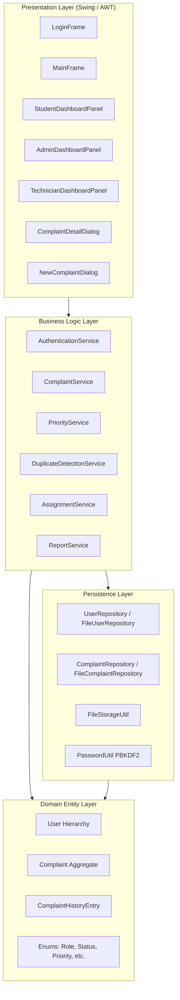
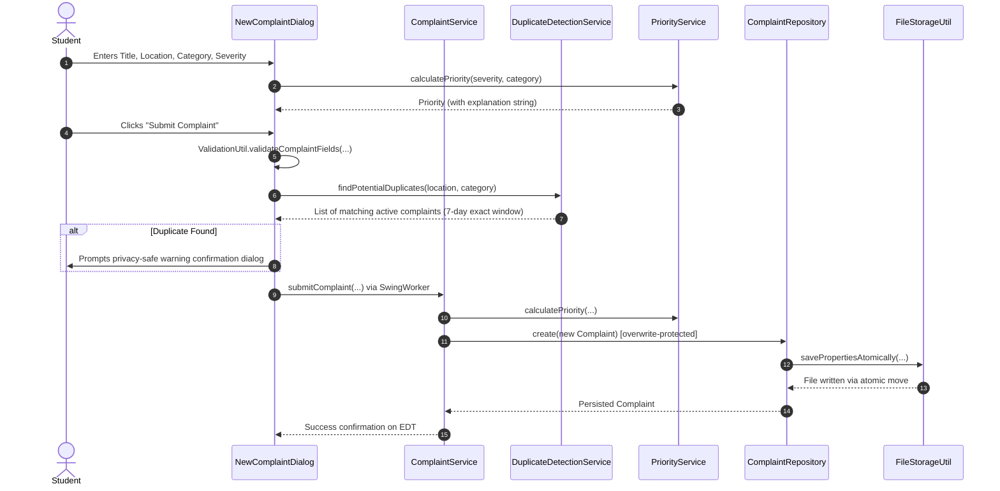

# CampusFix – Technical Architecture Specification

## 1. High-Level Architecture Overview
CampusFix is built using a clean, layered architecture that strictly separates presentation concerns, business rules, domain entities, and data persistence:

---

## 2. Service-Repository Decoupling
To adhere to the Dependency Inversion Principle, business services do not interact directly with file paths or disk I/O. Instead, they depend on abstract repository interfaces:
- `ComplaintService` depends on `ComplaintRepository`.
- `AuthenticationService` depends on `UserRepository`.
- `AssignmentService` depends on `ComplaintRepository` and `UserRepository`.

This design decouples storage implementations (e.g., swapping from `Properties` files to an embedded SQLite or in-memory mock during tests) without altering a single line of business logic.

---

## 3. Data Flow & Complaint Lifecycle Sequence

---

## 4. Concurrency & Thread-Safety Design
Although CampusFix is a desktop application, Swing event-dispatch threading and background I/O tasks require strict concurrency protection:
1. **EDT Isolation (`SwingWorker`):** Slow cryptographic PBKDF2 hashing, complaint persistence, technician creation, and CSV exports run off the Event Dispatch Thread via `SwingWorker`, while all Swing component updates occur strictly on the EDT.
2. **Repository Synchronization & Overwrite Protection:** `FileUserRepository` and `FileComplaintRepository` protect read/write operations using dedicated object monitor locks (`synchronized (lock)`), and `create(...)` rejects colliding record IDs so existing valid records can never be accidentally overwritten.
3. **Atomic File Swapping:** All file writes (`.properties` records and `.csv` reports) stage content to temporary sibling files (`.tmp.<nanoTime>`) before invoking `Files.move(..., StandardCopyOption.ATOMIC_MOVE, StandardCopyOption.REPLACE_EXISTING)`. If a process terminates mid-write, existing records remain intact.
4. **Immutability & Defensive Collections:** Value objects (`ComplaintHistoryEntry`, `ComplaintSummaryReport`, `TechnicianWorkloadEntry`, `DuplicateGroup`) are immutable, and `Complaint.getAuditHistory()` returns `Collections.unmodifiableList(...)`.

---

## 5. Cross-Platform Desktop UI Architecture
- **Deterministic Light Theme (`UITheme`):** Uses `UIManager.getCrossPlatformLookAndFeelClassName()` paired with custom lightweight Swing UI delegates (`BasicComboBoxUI`, `BasicScrollBarUI`, `BasicTextFieldUI`, `ModernTable.DirectPillBadgeRenderer`, and `ModernHeaderRenderer`) to prevent OS dark-theme (such as Linux GTK dark mode) contrast collisions.
- **Role-Based Navigation (`MainFrame`):** Dark-slate sidebar switches live views via `CardLayout` with zero decorative buttons:
  - **Student / Staff:** Dashboard, My Complaints, + New Complaint
  - **Administrator:** Dashboard Overview, All Complaints, Duplicate Review, Overdue Queue, Technicians, Reports & Export
  - **Technician:** Technician Dashboard, Assigned Tasks

---

## 5. Security & Cryptographic Architecture
- **PBKDF2 Hashing:** Password hashing uses `PBKDF2WithHmacSHA256` with 65,536 iterations and 256-bit key length.
- **Salt Generation:** Unique 16-byte cryptographically secure random salts are produced via `SecureRandom` per user record.
- **Constant-Time Verification:** Hash comparisons use `MessageDigest.isEqual(...)` to prevent side-channel timing attacks.
- **Memory Zeroization:** Plaintext password `char[]` arrays are immediately overwritten with `'\0'` after hashing or validation.
- **Formula Injection Mitigation:** `CsvExportUtil` sanitizes cells starting with `=`, `+`, `-`, `@`, `\t`, or `\r` by prepending a single quote (`'`), neutralizing spreadsheet formula execution.
