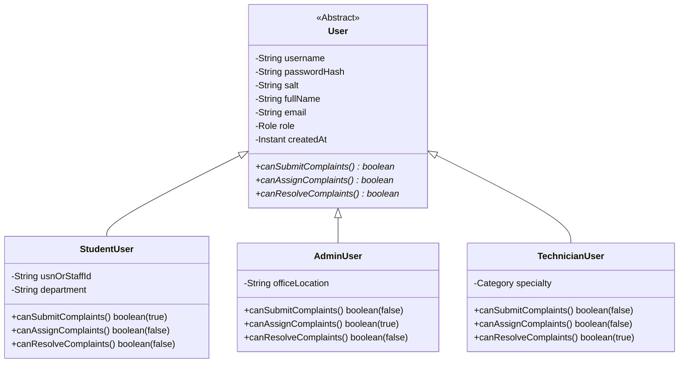
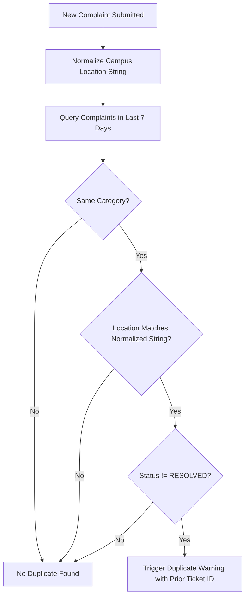

# CampusFix – Comprehensive System Manual & Architectural Blueprint

> **Academic Course:** Object-Oriented Programming with Java (3rd Semester B.E. / B.Tech)  
> **Target Runtime:** OpenJDK 17+ (Java Standard Library Exclusively)  
> **Architecture Pattern:** Four-Layer Clean Architecture with Pure Dependency Injection  
> **UI Toolkit:** Java Swing & AWT with Custom Design Tokens  
> **Persistence Engine:** Atomic Flat-File Key-Value Storage (`java.util.Properties` + Java NIO)  
> **Cryptographic Engine:** PBKDF2 with HMAC-SHA256 & 16-Byte Cryptographic Salt  

---

## Table of Contents
1. [Executive Summary & Project Core](#1-executive-summary--project-core)
2. [Prerequisites & Environment Setup](#2-prerequisites--environment-setup)
3. [How to Compile the Application](#3-how-to-compile-the-application)
4. [How to Run the Application](#4-how-to-run-the-application)
   - [Option A: Graphical Desktop Application (Standard GUI)](#option-a-graphical-desktop-application-standard-gui)
   - [Option B: Headless / CLI Verification Mode](#option-b-headless--cli-verification-mode)
   - [Option C: Automated Test Suite Execution](#option-c-automated-test-suite-execution)
5. [Step-by-Step Interactive Walkthrough](#5-step-by-step-interactive-walkthrough)
6. [How Everything Works: Architecture & Deep Dive](#6-how-everything-works-architecture--deep-dive)
   - [6.1 Layered Architecture Pattern & Dependency Injection](#61-layered-architecture-pattern--dependency-injection)
   - [6.2 Domain Model & Polymorphic User Hierarchy](#62-domain-model--polymorphic-user-hierarchy)
   - [6.3 Complaint Lifecycle & State Machine](#63-complaint-lifecycle--state-machine)
   - [6.4 Deterministic Priority Calculation Engine](#64-deterministic-priority-calculation-engine)
   - [6.5 7-Day Duplicate Detection Algorithm](#65-7-day-duplicate-detection-algorithm)
   - [6.6 Role-Based Access Control (RBAC) & Service-Layer Security](#66-role-based-access-control-rbac--service-layer-security)
   - [6.7 Atomic File Persistence & Corrupt Record Quarantine](#67-atomic-file-persistence--corrupt-record-quarantine)
   - [6.8 Analytics & RFC-4180 CSV Export (Formula Injection Safe)](#68-analytics--rfc-4180-csv-export-formula-injection-safe)
   - [6.9 Desktop UI Architecture & Modern Design Tokens](#69-desktop-ui-architecture--modern-design-tokens)
7. [Source Code Directory & Complete Class Map](#7-source-code-directory--complete-class-map)
8. [Troubleshooting & Frequently Asked Questions (FAQ)](#8-troubleshooting--frequently-asked-questions-faq)

---

## 1. Executive Summary & Project Core

**CampusFix** is an enterprise-inspired campus infrastructure maintenance and work order dispatch system designed and engineered for educational institutions. In typical university campuses, infrastructure maintenance suffers from uncoordinated communication channels (verbal requests, paper registers, unmonitored WhatsApp groups), resulting in duplicate dispatches, unaddressed safety hazards, and zero accountability.

CampusFix provides a centralized, secure, role-based desktop solution implemented **entirely with standard Java (JDK 17+)** without relying on third-party frameworks like Spring, Hibernate, Maven/Gradle runtime plugins, or external SQL database engines.

### Three Primary Actors

| Actor | Role | Permissions & Core Responsibilities |
|---|---|---|
| **Student / Faculty** | `STUDENT` | Register individual accounts, log maintenance complaints, choose campus location, select category/severity, review real-time priority scores, view duplicate alerts, and monitor personal ticket lifecycles. |
| **Campus Administrator** | `ADMIN` | Oversee all campus infrastructure, inspect real-time KPI metrics, register technicians with specialized trade skills, evaluate duplicate complaints, and dispatch work orders to technicians based on live active workloads. |
| **Maintenance Technician** | `TECHNICIAN` | View personalized work queues, advance tickets through enforced lifecycle stages (`ASSIGNED` $\rightarrow$ `IN_PROGRESS` $\rightarrow$ `RESOLVED`), submit mandatory resolution notes upon repair, and inspect historical repair logs. |

---

## 2. Prerequisites & Environment Setup

### 2.1 Java Development Kit (JDK) Requirement
CampusFix requires **JDK 17 or higher** (tested and validated on OpenJDK 17 LTS, OpenJDK 21 LTS, and OpenJDK 25). The project uses Java standard library features including:
- Java NIO File API (`java.nio.file.Files`, `java.nio.file.StandardCopyOption`)
- Java Cryptography Architecture (`javax.crypto.SecretKeyFactory`, `java.security.SecureRandom`)
- Modern Date-Time API (`java.time.Instant`, `java.time.Duration`, `java.time.temporal.ChronoUnit`)
- Java Collections Framework (`Stream`, `List`, `Map`, `Optional`, `Comparator`)
- Java Swing & AWT for desktop presentation.

### 2.2 Verifying Your Java Installation
Run the following commands in your terminal or command prompt:

```bash
javac -version
java -version
```

**Expected output:**
```text
javac 21.0.13 (or any version >= 17.0.0)
openjdk version "21.0.13" ... (or any version >= 17.0.0)
```

If `javac` is not recognized, ensure that your `JAVA_HOME` environment variable points to a valid JDK installation directory and that `$JAVA_HOME/bin` (or `%JAVA_HOME%\bin` on Windows) is present in your system `PATH`.

### 2.3 Operating System Compatibility
- **Linux:** Fully supported. Requires an active X11 or Wayland display server for the GUI. For headless servers or SSH terminals, use the `--headless` mode.
- **macOS:** Fully supported out of the box via macOS native Cocoa Swing integration.
- **Windows (10 / 11):** Fully supported via Windows desktop windowing manager.

---

## 3. How to Compile the Application

The project has zero external dependencies; compiling requires only standard `javac`.

### 3.1 Option 1: Compilation via Provided Shell Script (Linux / macOS)
A build script `compile.sh` is provided in the repository root. It cleans previous builds, checks the JDK version, and compiles all source files with strict linting:

```bash
chmod +x compile.sh run.sh
./compile.sh
```

**Script execution output:**
```text
Using compiler: javac 21.0.13
Compiling CampusFix sources...
Build successful! Classes written to out/
```

### 3.2 Option 2: Direct Manual Compilation (Linux / macOS)
If compiling manually without using the shell script:

```bash
# Create target directory for compiled bytecode
mkdir -p out

# Compile all source files into the out/ directory
javac -encoding UTF-8 -Xlint:all -d out $(find src -name "*.java")
```

### 3.3 Option 3: Manual Compilation on Windows

**Windows Command Prompt (`cmd.exe`):**
```cmd
if not exist out mkdir out
dir /s /b src\*.java > sources.txt
javac -encoding UTF-8 -d out @sources.txt
del sources.txt
```

**Windows PowerShell:**
```powershell
New-Item -ItemType Directory -Force -Path out
Get-ChildItem -Recurse -Filter *.java src | Resolve-Path -Relative | Out-File -Encoding utf8 sources.txt
javac -encoding UTF-8 -d out @sources.txt
Remove-Item sources.txt
```

### 3.4 Runtime Artifact Directories
Upon compilation and execution, the application interacts with the following root-level directories:

```text
campusfix-root/
├── out/                    # Compiled .class files
├── data/
│   ├── users/              # Serialized User credentials & profiles (.properties)
│   ├── complaints/         # Serialized Complaints & history logs (.properties)
│   └── config/             # Application configuration files
└── reports/                # Exported CSV analytics reports (complaints_summary.csv)
```

*Note: All data directories are created automatically by `FileStorageUtil` if they do not yet exist.*

---

## 4. How to Run the Application

CampusFix supports three distinct runtime execution modes:

```
                          ┌───────────────────────────┐
                          │   edu.nie.campusfix.Main   │
                          └─────────────┬─────────────┘
                                        │
           ┌────────────────────────────┼────────────────────────────┐
           ▼                            ▼                            ▼
┌──────────────────────┐     ┌──────────────────────┐     ┌──────────────────────┐
│  Desktop GUI Mode    │     │  Headless CLI Mode   │     │ Automated Test Suite │
│  (Default / run.sh)  │     │   (--headless flag)  │     │     (TestRunner)     │
└──────────────────────┘     └──────────────────────┘     └──────────────────────┘
```

---

### Option A: Graphical Desktop Application (Standard GUI)

To launch the full graphical desktop interface:

```bash
# Via execution script
./run.sh

# Or via direct Java invocation
java -cp out edu.nie.campusfix.Main
```

On Windows:
```cmd
java -cp out edu.nie.campusfix.Main
```

**What to expect:**
- The application checks whether an initial system administrator account exists in `data/users/`.
- If no administrator exists (fresh installation), it presents the **Initial Administrator Setup Dialog**.
- Once configured, the modern dark-themed **Login Screen** appears, allowing Students, Administrators, and Technicians to log in.

---

### Option B: Headless / CLI Verification Mode

For automated continuous integration (CI/CD) pipelines, headless Linux servers, remote SSH terminals, or quick system health verification where no graphical display (X11 / Wayland) is available:

```bash
java -cp out edu.nie.campusfix.Main --headless
```
*(Accepts `--headless`, `--cli`, or `--status`)*

**Actual Terminal Output:**
```text
==================================================
CampusFix – Smart Campus Maintenance System
Object-Oriented Programming with Java (Experiential Learning)
==================================================
[CampusFix] Running in headless / CLI mode.
Status Summary:
 - Total Complaints: 0
 - Pending: 0
 - Assigned: 0
 - In Progress: 0
 - Resolved: 0
 - Overdue: 0
Admin initialized: true
To launch desktop GUI, run in an X11/Wayland display environment.
```

**Key Advantages of Headless Mode:**
1. Verifies that all service layers, repositories, and persistence engines initialize without error.
2. Reads and calculates real-time complaint KPIs and SLA overdue statuses without launching a graphical window.
3. Exits with exit code `0`, making it safe for automated build testing and container sanity checks.

---

### Option C: Automated Test Suite Execution

CampusFix includes an independent, zero-dependency unit and integration test runner (`edu.nie.campusfix.tests.TestRunner`) containing **30 comprehensive test cases**.

Run the test suite using:

```bash
java -cp out edu.nie.campusfix.tests.TestRunner
```

**Expected Terminal Output:**
```text
==================================================
Running CampusFix Test Suite (30 Tests)
==================================================
[PASS] Test 01: Initial administrator setup works.
[PASS] Test 02: Student account registration works.
[PASS] Test 03: Invalid registration input is rejected.
[PASS] Test 04: Correct login credentials are accepted.
[PASS] Test 05: Incorrect credentials are rejected.
[PASS] Test 06: Student complaint creation works.
[PASS] Test 07: Unique complaint IDs are generated.
[PASS] Test 08: Priority calculation is correct.
[PASS] Test 09: Duplicate complaint warnings are generated correctly.
[PASS] Test 10: Different locations do not cause false duplicate matches.
[PASS] Test 11: Administrator can assign technicians.
[PASS] Test 12: Student cannot assign technicians.
[PASS] Test 13: Technician can view assigned complaints.
[PASS] Test 14: Technician cannot modify unrelated complaints.
[PASS] Test 15: Valid status transitions succeed.
[PASS] Test 16: Invalid status transitions fail safely.
[PASS] Test 17: Resolution notes are saved.
[PASS] Test 18: Complaint history is recorded correctly.
[PASS] Test 19: Overdue classification is correct.
[PASS] Test 20: Dashboard totals are calculated correctly.
[PASS] Test 21: Complaint searches and filters work.
[PASS] Test 22: CSV report export works.
[PASS] Test 23: Application data survives restart/reload.
[CampusFix] Warning: Skipping malformed user file corrupt_user.properties: Missing mandatory user fields in properties
[CampusFix] Isolated corrupted record to: /tmp/campusfix_test_env_.../corrupt_user.properties.corrupt...
[PASS] Test 24: Corrupted data is reported safely.
[PASS] Test 25: Application handles an empty complaint database.
[PASS] Test 26: Administrator privileges cannot be obtained through public registration.
[PASS] Test 27: All priority combinations produce the expected result.
[PASS] Test 28: User and complaint records cannot be accidentally overwritten.
[PASS] Test 29: All generated Java classes compile successfully.
[PASS] Test 30: A complete complaint workflow can be executed from creation to resolution.
==================================================
RESULTS: 30 / 30 Passed (0 Failed)
==================================================
```

**Testing Isolation Guarantee:**
The test suite creates a dedicated, ephemeral temporary directory in `/tmp/campusfix_test_env_<nanoTime>/`. It executes all 30 tests in complete sandbox isolation and recursively purges the directory upon completion. **Running tests will never alter, corrupt, or overwrite your production `data/` directory.**

---

## 5. Step-by-Step Interactive Walkthrough

Here is the complete operational lifecycle of CampusFix from initial deployment to work order completion:

```
┌─────────────────┐       ┌────────────────────┐       ┌────────────────────┐       ┌─────────────────────┐
│ 1. First Boot   │       │ 2. Admin Onboarding│       │ 3. Student Logging │       │ 4. Admin Dispatch   │
│ Initial Admin   │──────>│ Register Technicians│──────>│ Create Complaint   │──────>│ Workload-Aware      │
│ Setup Wizard    │       │ (Specialty Skills) │       │ (Live Priority)    │       │ Technician Assign   │
└─────────────────┘       └────────────────────┘       └────────────────────┘       └──────────┬──────────┘
                                                                                               │
                                                                                               ▼
┌─────────────────┐       ┌────────────────────┐       ┌────────────────────┐       ┌─────────────────────┐
│ Complete Audit  │       │ 7. CSV Export      │       │ 6. Resolution Log  │       │ 5. Technician Action│
│ Immutable Trail │<──────│ RFC-4180 / Safe    │<──────│ Status -> RESOLVED │<──────│ PENDING -> IN_PROG  │
│ Verification    │       │ Spreadsheet Report │       │ Add Tech Notes     │       │ Work Execution      │
└─────────────────┘       └────────────────────┘       └────────────────────┘       └─────────────────────┘
```

### Step 1: Initial Administrator Setup
1. Launch the application: `java -cp out edu.nie.campusfix.Main`.
2. Because no users exist in `data/users/`, `AuthenticationService.isInitialAdminSetupRequired()` evaluates to `true`.
3. A modal dialog prompts for initial Administrator credentials:
   - **Username:** `admin`
   - **Full Name:** `Campus Estate Manager`
   - **Email:** `admin@nie.ac.in`
   - **Password:** `Admin@1234`
4. The system hashes the password using PBKDF2 with a unique 16-byte cryptographic salt and saves the administrator account to `data/users/admin.properties`.

### Step 2: Administrator Logs In & Registers Technicians
1. Log in using the newly created administrator credentials.
2. The **Administrator Dashboard** appears, presenting live KPI cards: Total Complaints, Pending, Assigned, In Progress, Resolved, and Overdue.
3. Click the **"+ Register New Technician"** button on the top-right toolbar.
4. Fill in the technician details:
   - **Username:** `tech_rajesh`
   - **Full Name:** `Rajesh Kumar`
   - **Email:** `rajesh.maintenance@nie.ac.in`
   - **Specialty Trade:** Select `ELECTRICAL` (options: `ELECTRICAL`, `PLUMBING`, `CARPENTRY`, `HVAC_AC`, `CIVIL_MASONRY`, `IT_NETWORKING`, `CLEANLINESS`, `GENERAL_MAINTENANCE`).
   - **Default Password:** `Tech@1234`
5. The account is created with `Role.TECHNICIAN` and stored safely.

### Step 3: Student Registration & Self-Service Login
1. Click **"Logout"** on the admin panel to return to the login screen.
2. Switch to the **"Register New Account"** tab.
3. Register a student account:
   - **USN / Staff ID:** `4NI22CS085`
   - **Full Name:** `Ananya Sharma`
   - **Email:** `ananya.cs22@nie.ac.in`
   - **Department / Branch:** `Computer Science & Engineering`
   - **Password:** `Student@1234`
4. The account is created with `Role.STUDENT`. Students *cannot* grant themselves elevated roles; the system hard-codes `Role.STUDENT` on this endpoint.
5. Log in using `4NI22CS085` and `Student@1234`.

### Step 4: Submitting a Complaint with Live Priority Scoring
1. The **Student Dashboard** loads, displaying personal complaint history.
2. Click **"+ Lodge New Complaint"**.
3. Select parameters in the dialog:
   - **Category:** `ELECTRICAL`
   - **Severity:** `HIGH`
   - **Campus Location:** `Room 304, Mechanical Engineering Block`
   - **Title:** `Ceiling fan spark and burning smell`
   - **Description:** `The third ceiling fan near the rear projector sparked loudly and emitted a strong acrid burning odor. Currently switched off.`
4. Notice the **Live Priority Calculator Badge**:
   - Severity `HIGH` (Base score: 3) + High-Risk Category `ELECTRICAL` (+1 Bonus) = Score 4 $\rightarrow$ **CRITICAL (SLA: 24h)**.
5. Click **"Submit Complaint"**.
6. The complaint is allocated a collision-resistant tracking ID (e.g., `CMP-2025-0001`), logged in `PENDING` state, and immediately visible in the student's personal table.

### Step 5: Duplicate Detection in Action
1. While still logged in as a student, click **"+ Lodge New Complaint"** again.
2. Enter the same category and location:
   - **Category:** `ELECTRICAL`
   - **Severity:** `MEDIUM`
   - **Campus Location:** `Room 304 Mechanical Engineering Block` *(note slight variation in punctuation/spaces)*
   - **Title:** `Fan is broken in Room 304`
3. Click **"Submit Complaint"**.
4. The **Duplicate Warning Dialog** triggers!
   - The engine normalizes the location string, scans the 7-day rolling window, identifies existing active ticket `CMP-2025-0001`, and prompts:
     > *"A similar ELECTRICAL complaint was recently submitted for 'Room 304, Mechanical Engineering Block' on 2025-... (Status: PENDING). Are you sure you want to log another ticket?"*
5. The student can choose to cancel (preventing redundant work orders) or proceed if it is a distinct issue.

### Step 6: Administrator Work Order Assignment
1. Log out and re-login as `admin`.
2. In the Admin Dashboard table, select `CMP-2025-0001` (highlighted in red as `CRITICAL`).
3. Click **"Assign Technician"**.
4. The **Technician Assignment Modal** opens, listing all registered technicians.
   - For each technician, it displays: Full Name, Specialty, and **Current Active Workload** (e.g., `"0 active complaints assigned"`).
5. Select `Rajesh Kumar (ELECTRICAL)` and click **"Confirm Assignment"**.
6. The state transitions atomically: `PENDING` $\rightarrow$ `ASSIGNED`.
7. An audit history entry is appended: `ASSIGNED: Assigned to Rajesh Kumar (tech_rajesh) by admin`.

### Step 7: Technician Work Order Execution & Resolution
1. Log out and log in as technician `tech_rajesh`.
2. The **Technician Dashboard** displays work orders specifically assigned to Rajesh Kumar.
3. Select `CMP-2025-0001`. Click **"Start Work"**.
   - State transitions: `ASSIGNED` $\rightarrow$ `IN_PROGRESS`.
   - History logged: `STATUS_CHANGE: Status changed from ASSIGNED to IN_PROGRESS`.
4. After repairing the fan, click **"Mark as Resolved"**.
5. The **Resolution Modal** prompts for mandatory resolution documentation:
   - **Resolution Notes:** *"Replaced faulty capacitor and defective ball bearings on fan #3. Insulation tested safe. Working normally."*
6. Click **"Submit Resolution"**.
   - State transitions: `IN_PROGRESS` $\rightarrow$ `RESOLVED`.
   - The resolved timestamp is recorded; SLA clock stops.
   - The ticket disappears from active queues and appears in historical records.

### Step 8: Reports & CSV Export
1. Log in as `admin`.
2. Click **"Export CSV Report"** in the top navigation bar.
3. The system generates `reports/complaints_summary.csv`.
4. Open the CSV file in Excel, LibreOffice Calc, or any text editor.
   - All complaint attributes, calculated SLA hours, assigned technicians, and resolution notes are exported cleanly.
   - Any fields starting with potential formula triggers (`=`, `+`, `-`, `@`) have been sanitized with leading apostrophes to protect the spreadsheet from formula injection attacks.

---

## 6. How Everything Works: Architecture & Deep Dive

### 6.1 Layered Architecture Pattern & Dependency Injection

CampusFix strictly follows the **Four-Layer Architecture Pattern**, guaranteeing high cohesion and loose coupling.

```
┌─────────────────────────────────────────────────────────────────────────────┐
│ 1. PRESENTATION LAYER (edu.nie.campusfix.ui.*)                             │
│    - Frames: LoginFrame, MainFrame                                          │
│    - Panels: StudentDashboardPanel, AdminDashboardPanel, TechDashboardPanel  │
│    - Dialogs: NewComplaintDialog, AssignTechnicianDialog, ResolveDialog...  │
│    - Design Tokens & Components: UITheme, PillBadge, StatCard, ModernTable  │
└──────────────────────────────────────┬──────────────────────────────────────┘
                                       │ Calls Service Methods
┌──────────────────────────────────────▼──────────────────────────────────────┐
│ 2. BUSINESS SERVICE LAYER (edu.nie.campusfix.service.*)                     │
│    - AuthenticationService: Session state, RBAC validation, PBKDF2 hashing  │
│    - ComplaintService: Submission, search filters, state transitions, SLA   │
│    - AssignmentService: Workload checks, technician dispatch                │
│    - PriorityService: Deterministic scoring engine                          │
│    - DuplicateDetectionService: String normalization & 7-day query window   │
│    - ReportService: KPI metric aggregation, CSV generation                  │
└──────────────────────────────────────┬──────────────────────────────────────┘
                                       │ Interacts with Entities & Repositories
┌──────────────────────────────────────▼──────────────────────────────────────┐
│ 3. DOMAIN ENTITY LAYER (edu.nie.campusfix.model.* & enums.*)                │
│    - User (Abstract): StudentUser, AdminUser, TechnicianUser                │
│    - Complaint: Aggregate root tracking status, priority, timestamps        │
│    - ComplaintHistoryEntry: Immutable chronological audit log records       │
│    - Enums: Role, Category, Severity, Priority, ComplaintStatus, AuditType  │
└──────────────────────────────────────┬──────────────────────────────────────┘
                                       │ Reads / Writes via Repository APIs
┌──────────────────────────────────────▼──────────────────────────────────────┐
│ 4. DATA PERSISTENCE LAYER (edu.nie.campusfix.repository.* & util.*)         │
│    - Interfaces: Repository<T, ID>, UserRepository, ComplaintRepository    │
│    - Implementations: FileUserRepository, FileComplaintRepository           │
│    - Utilities: FileStorageUtil (Atomic writes, quarantine), PasswordUtil   │
│                 ValidationUtil (Regex guards), CsvExportUtil (Sanitization) │
└─────────────────────────────────────────────────────────────────────────────┘
```

#### Pure Java Dependency Injection in `Main.java`
No external IoC container (like Spring) is used. Instead, `Main.java` acts as the system composition root, wiring dependencies cleanly:

```java
// 1. Instantiate Storage Repositories
Path dataDir = Paths.get("data");
UserRepository userRepo = new FileUserRepository(dataDir.resolve("users"));
ComplaintRepository complaintRepo = new FileComplaintRepository(dataDir.resolve("complaints"));

// 2. Instantiate Business Services
PriorityService priorityService = new PriorityService();
DuplicateDetectionService duplicateService = new DuplicateDetectionService(complaintRepo);
AuthenticationService authService = new AuthenticationService(userRepo);
ComplaintService complaintService = new ComplaintService(complaintRepo, userRepo, priorityService, duplicateService);
AssignmentService assignmentService = new AssignmentService(complaintRepo, userRepo);
ReportService reportService = new ReportService(complaintRepo, userRepo);

// 3. Inject Services into Presentation UI
SwingUtilities.invokeLater(() -> {
    new LoginFrame(authService, complaintService, assignmentService, reportService).setVisible(true);
});
```

---

### 6.2 Domain Model & Polymorphic User Hierarchy

CampusFix models actors using classic Object-Oriented Polymorphism:



#### Why This Matters in OOP Design:
- **Encapsulation:** All fields are `private` with validated getters/setters. Sensitive fields (like `salt` and `passwordHash`) cannot be tampered with directly.
- **Polymorphism:** The system invokes `currentUser.canAssignComplaints()` without needing brittle `if (user instanceof AdminUser)` type checks across every controller.
- **Immutability in Audit Logs:** `ComplaintHistoryEntry` is completely immutable: fields are initialized strictly via the constructor with no setters, guaranteeing that history records cannot be modified after being logged.

---

### 6.3 Complaint Lifecycle & State Machine

A complaint progresses through an enforced, deterministic finite state machine:

```
          [Student Submits]
                  │
                  ▼
         ┌─────────────────┐
         │     PENDING     │ <── Registered in system; awaiting review
         └────────┬────────┘
                  │ [Admin assigns to Technician]
                  ▼
         ┌─────────────────┐
         │    ASSIGNED     │ <── Work order dispatched to specific technician
         └────────┬────────┘
                  │ [Technician starts work]
                  ▼
         ┌─────────────────┐
         │   IN_PROGRESS   │ <── Technician actively repairing on site
         └────────┬────────┘
                  │ [Technician supplies resolution notes]
                  ▼
         ┌─────────────────┐
         │    RESOLVED     │ <── Closed; SLA clock stops; repair notes saved
         └─────────────────┘
```

#### Valid and Illegal Transition Matrix

| From State | Valid Next State | Triggering Actor | Enforcing Method |
|---|---|---|---|
| `PENDING` | `ASSIGNED` | Administrator | `AssignmentService.assignTechnician(...)` |
| `ASSIGNED` | `IN_PROGRESS` | Assigned Technician | `ComplaintService.updateStatus(..., IN_PROGRESS, ...)` |
| `IN_PROGRESS` | `RESOLVED` | Assigned Technician | `ComplaintService.resolveComplaint(..., notes, ...)` |
| `ASSIGNED` | `RESOLVED` | Assigned Technician | Direct resolution if work is instant |
| *Any* | `PENDING` | *None (Illegal)* | Throws `ValidationException` |
| `RESOLVED` | *Any* | *None (Illegal)* | Terminal state; throws `ValidationException` |

#### Overdue SLA Response Tracking
Each complaint is assigned a maximum acceptable turnaround window based on its priority level:

$$\text{Response Target} = \text{createdAt} + \text{SLA Duration}$$

| Priority | SLA Duration | Target Resolution Window |
|---|---|---|
| **CRITICAL** | 24 Hours | Immediate emergency response (same day) |
| **HIGH** | 48 Hours | 2 Business Days |
| **MEDIUM** | 72 Hours | 3 Business Days |
| **LOW** | 168 Hours | 7 Calendar Days |

**Overdue Evaluation Rule (`Complaint.isOverdue()`):**
```java
public boolean isOverdue() {
    if (this.status == ComplaintStatus.RESOLVED) {
        return false; // Resolved tickets are never overdue
    }
    return Instant.now().isAfter(this.responseTarget);
}
```

---

### 6.4 Deterministic Priority Calculation Engine

CampusFix rejects subjective, arbitrary priority assignments. Instead, `PriorityService` calculates priority deterministically using an explainable mathematical formula:

$$\text{Final Score} = \min\Big(4, \;\max\big(1, \;\text{BaseScore}(\text{Severity}) + \text{RiskBonus}(\text{Category})\big)\Big)$$

#### 1. Severity Base Score
- `LOW` $\rightarrow$ Base Score = **1**
- `MEDIUM` $\rightarrow$ Base Score = **2**
- `HIGH` $\rightarrow$ Base Score = **3**

#### 2. Category Risk Bonus
- High-hazard categories (`Category.ELECTRICAL`, `Category.SAFETY`) represent threats to life and campus infrastructure and receive a **+1 Risk Bonus**.
- Standard operational categories (`PLUMBING`, `CARPENTRY`, `HVAC_AC`, `CIVIL_MASONRY`, `IT_NETWORKING`, `CLEANLINESS`, `GENERAL_MAINTENANCE`) receive a **+0 Bonus**.

#### 3. Score-to-Priority Mapping Table
The resulting score (clamped between 1 and 4) maps to the priority scale:

| Category | Severity | Base Score | Risk Bonus | Final Score | Resulting Priority | Target SLA |
|---|---|:---:|:---:|:---:|:---:|:---:|
| `ELECTRICAL` or `SAFETY` | `HIGH` | 3 | +1 | **4** | **CRITICAL** | 24 Hours |
| `ELECTRICAL` or `SAFETY` | `MEDIUM` | 2 | +1 | **3** | **HIGH** | 48 Hours |
| `ELECTRICAL` or `SAFETY` | `LOW` | 1 | +1 | **2** | **MEDIUM** | 72 Hours |
| Any Standard Category | `HIGH` | 3 | +0 | **3** | **HIGH** | 48 Hours |
| Any Standard Category | `MEDIUM` | 2 | +0 | **2** | **MEDIUM** | 72 Hours |
| Any Standard Category | `LOW` | 1 | +0 | **1** | **LOW** | 168 Hours (7d) |

*Why this design?* If a student reports a flickering light in a lecture hall with `LOW` severity, the electrical risk automatically elevates the ticket to `MEDIUM` priority so it is resolved within 72 hours rather than lingering for a week.

---

### 6.5 7-Day Duplicate Detection Algorithm

Redundant maintenance reporting is a major cause of administrative waste. `DuplicateDetectionService` identifies matching unresolved complaints submitted within a rolling 7-day window.



#### String Normalization Pipeline (`normalizeLocation`):
Human users type locations inconsistently (e.g., `"Room 304, Mech Block"`, `"room 304 mech  block"`, `"ROOM 304 - Mech. Block"`). Before comparison, the string is normalized:
```java
public static String normalizeLocation(String location) {
    if (location == null) return "";
    return location.toLowerCase(Locale.ROOT)
                   .replaceAll("[^a-z0-9\\s]", " ")  // Strip punctuation
                   .replaceAll("\\s+", " ")          // Collapse whitespace
                   .trim();
}
```

#### Rolling Window Filtering:
```java
Instant cutoff = Instant.now().minus(7, ChronoUnit.DAYS);

List<Complaint> candidates = complaintRepository.findByCategory(category).stream()
    .filter(c -> c.getStatus() != ComplaintStatus.RESOLVED)
    .filter(c -> c.getCreatedAt().isAfter(cutoff))
    .filter(c -> normalizeLocation(c.getLocation()).equals(normalizedTargetLocation))
    .collect(Collectors.toList());
```

---

### 6.6 Role-Based Access Control (RBAC) & Service-Layer Security

Security in CampusFix is enforced through **Defense-in-Depth**:
1. **Presentation Layer Guard:** UI components conditionally display or disable buttons (e.g., a student cannot see the "Assign Technician" button).
2. **Service Layer Hard Enforcement:** Even if UI reflection or external calls attempt unauthorized actions, every service method validates permissions and throws `UnauthorizedException`:

```java
// Enforced in AssignmentService.java
public Complaint assignTechnician(String complaintId, String technicianUsername, User actingUser) {
    if (actingUser == null || !actingUser.canAssignComplaints()) {
        throw new UnauthorizedException("Only administrators can assign technicians to complaints.");
    }
    // ... proceed with assignment
}
```

#### PBKDF2 Password Cryptography (`PasswordUtil.java`)
Passwords are never stored in plaintext. CampusFix implements PBKDF2 (Password-Based Key Derivation Function 2) recommended by NIST:

- **Algorithm:** `PBKDF2WithHmacSHA256`
- **Salt:** 16 bytes generated by `java.security.SecureRandom`
- **Work Factor (Iterations):** 65,536 rounds
- **Key Length:** 256 bits

```
Plain Password + 16-Byte Cryptographic Salt
                    │
                    ▼
       PBKDF2WithHmacSHA256 (65,536 Rounds)
                    │
                    ▼
          Hex-Encoded Stored Hash
```

---

### 6.7 Atomic File Persistence & Corrupt Record Quarantine

CampusFix achieves enterprise-grade file reliability without any database engine using two key mechanisms in `FileStorageUtil.java`:

#### 1. Atomic Move Pattern (`savePropertiesAtomically`)
Writing directly to a target file risks catastrophic corruption if the application process is terminated mid-write or the system encounters a power loss. CampusFix uses a staged write-and-rename pattern:

```java
Path tempFile = dir.resolve(filename + ".tmp." + System.nanoTime());

// 1. Write completely to temporary file
try (OutputStream out = Files.newOutputStream(tempFile)) {
    properties.store(out, "CampusFix Stored Record");
}

// 2. Perform atomic file system swap
Files.move(tempFile, targetFile, 
           StandardCopyOption.ATOMIC_MOVE, 
           StandardCopyOption.REPLACE_EXISTING);
```
Under POSIX and modern Windows NTFS file systems, `Files.move` with `ATOMIC_MOVE` is atomic: readers either observe the complete previous file or the complete new file, never a half-written intermediate state.

#### 2. Corrupted Record Quarantine Engine
If a disk block suffers corruption or a user manually edits a `.properties` file with invalid syntax, CampusFix does **not** crash. `FileStorageUtil.quarantineCorruptFile()` isolates the file:

```java
Path quarantinePath = file.resolveSibling(file.getFileName() + ".corrupt." + System.currentTimeMillis());
Files.move(file, quarantinePath, StandardCopyOption.REPLACE_EXISTING);
System.err.println("[CampusFix] Isolated corrupted record to: " + quarantinePath);
```
The application logs a warning, skips the damaged file, and continues booting normally.

#### 3. Path Traversal Attack Prevention
To prevent path traversal attacks (e.g., passing `../../etc/passwd` as an ID), `resolveSafePath()` verifies that the normalized target path remains strictly within the intended directory:

```java
Path resolved = baseDir.resolve(safeFilename).normalize();
if (!resolved.startsWith(baseDir.normalize())) {
    throw new SecurityException("Path traversal attempt detected: " + filename);
}
```

---

### 6.8 Analytics & RFC-4180 CSV Export (Formula Injection Safe)

The `ReportService` aggregates real-time complaint data for the executive dashboard:
- Total complaints logged
- Count by lifecycle status (`PENDING`, `ASSIGNED`, `IN_PROGRESS`, `RESOLVED`)
- Count of currently overdue complaints
- Breakdown of complaints across categories
- Active workload per technician

#### Formula Injection (CSV Injection) Prevention
When opening CSV reports in Microsoft Excel or Google Sheets, cells starting with characters like `=`, `+`, `-`, `@`, `\t`, or `\r` can execute arbitrary operating system commands via DDE (Dynamic Data Exchange) formulas.

`CsvExportUtil.java` sanitizes all exported text cells:
```java
public static String sanitizeForCsv(String value) {
    if (value == null) return "";
    String trimmed = value.trim();
    if (trimmed.startsWith("=") || trimmed.startsWith("+") || 
        trimmed.startsWith("-") || trimmed.startsWith("@") ||
        trimmed.startsWith("\t") || trimmed.startsWith("\r")) {
        // Prepend single quote to force spreadsheet programs to treat cell as literal text
        return "'" + trimmed;
    }
    return trimmed;
}
```

---

### 6.9 Desktop UI Architecture & Modern Design Tokens

CampusFix avoids the default, outdated Java Swing "Metal" look by implementing a custom design token architecture inspired by modern Tailwind / Linear web interfaces in `UITheme.java`.

#### Central Design Palette Tokens

| Token Name | Hex Code | Visual Swatch / Purpose |
|---|---|---|
| `BG_CANVAS` | `#0F172A` | Deep dark slate main application canvas background |
| `CARD_BG` | `#1E293B` | Elevated card and container background |
| `CARD_BORDER` | `#334155` | Subtle border for visual separation |
| `TEXT_PRIMARY` | `#F8FAFC` | High-contrast off-white primary text |
| `TEXT_MUTED` | `#94A3B8` | Subdued slate text for subtitles, labels, and timestamps |
| `ACCENT_BLUE` | `#4F46E5` | Vibrant indigo for primary action buttons and active indicators |
| `STATUS_PENDING` | `#F59E0B` | Amber warning badge |
| `STATUS_ASSIGNED` | `#3B82F6` | Sky blue badge |
| `STATUS_IN_PROGRESS` | `#8B5CF6` | Purple badge |
| `STATUS_RESOLVED` | `#10B981` | Emerald green success badge |
| `PRIORITY_CRITICAL` | `#EF4444` | Crimson red urgent hazard badge |

#### Custom Components
- **`ModernButton`:** Rounded anti-aliased button with smooth background transitions on mouse hover, custom focus rings, and dark-theme accents.
- **`ModernTable`:** Custom Swing table with alternating row striping, fixed header heights, custom cell renderers for status badges, and disabled cell editing.
- **`PillBadge`:** Self-sizing capsule badge component rendering semantic background tints and status colors with crisp rounded borders.
- **`StatCard`:** Reusable KPI metrics card displaying an accent-colored numeric total, descriptive title, and contextual status badge.

---

## 7. Source Code Directory & Complete Class Map

The codebase comprises **44 classes, interfaces, and enums** organized into 8 clean packages under `edu.nie.campusfix`:

```text
src/edu/nie/campusfix/
├── Main.java                          # Main entry point & DI composition root
├── enums/                             # Domain enumerations
│   ├── AuditActionType.java           # CREATED, ASSIGNED, STATUS_CHANGE, RESOLVED...
│   ├── Category.java                  # ELECTRICAL, PLUMBING, SAFETY, HVAC...
│   ├── ComplaintStatus.java           # PENDING, ASSIGNED, IN_PROGRESS, RESOLVED
│   ├── Priority.java                  # LOW, MEDIUM, HIGH, CRITICAL
│   ├── Role.java                      # STUDENT, ADMIN, TECHNICIAN
│   └── Severity.java                  # LOW, MEDIUM, HIGH
├── model/                             # Domain entities
│   ├── User.java                      # Abstract base user class
│   ├── StudentUser.java               # Concrete student entity
│   ├── AdminUser.java                 # Concrete administrator entity
│   ├── TechnicianUser.java            # Concrete technician entity with specialty
│   ├── Complaint.java                 # Aggregate root complaint model
│   └── ComplaintHistoryEntry.java     # Immutable audit log entry
├── repository/                        # Persistence contracts & flat-file drivers
│   ├── Repository.java                # Generic base repository interface
│   ├── UserRepository.java            # User repository interface
│   ├── ComplaintRepository.java       # Complaint repository interface
│   ├── FileUserRepository.java        # File-based user repository implementation
│   └── FileComplaintRepository.java   # File-based complaint repository implementation
├── service/                           # Business logic services
│   ├── AuthenticationService.java     # Registration, session, and authentication
│   ├── ComplaintService.java          # Complaint lifecycle, filtering, SLA logic
│   ├── AssignmentService.java         # Technician assignment and workload tracking
│   ├── PriorityService.java           # Deterministic priority scoring engine
│   ├── DuplicateDetectionService.java # 7-day duplicate detection engine
│   └── ReportService.java             # Dashboard metrics and CSV generation
├── util/                              # Cross-cutting utilities
│   ├── FileStorageUtil.java           # Atomic file writes and quarantine
│   ├── PasswordUtil.java              # PBKDF2 hashing and cryptographic salt
│   ├── ValidationUtil.java            # Input validation regex and safety rules
│   └── CsvExportUtil.java             # RFC-4180 CSV serialization and escaping
├── exception/                         # Domain exception hierarchy
│   ├── CampusFixException.java        # Base runtime exception
│   ├── AuthenticationException.java   # Invalid credentials or expired sessions
│   ├── UnauthorizedException.java     # RBAC privilege violations
│   ├── ValidationException.java       # Illegal inputs or invalid state transitions
│   ├── ResourceNotFoundException.java # Missing entity lookups
│   └── StorageException.java          # Low-level I/O or persistence failures
├── ui/                                # Presentation Swing desktop interfaces
│   ├── LoginFrame.java                # Authentication and registration window
│   ├── MainFrame.java                 # Main dashboard host window
│   ├── StudentDashboardPanel.java     # Student ticket submission & tracking panel
│   ├── AdminDashboardPanel.java       # Administrator oversight & dispatch panel
│   ├── TechnicianDashboardPanel.java  # Technician work order queue panel
│   ├── theme/
│   │   └── UITheme.java               # Central design tokens, fonts, and colors
│   ├── component/
│   │   ├── ModernButton.java          # Custom styled hoverable button
│   │   ├── ModernTable.java           # Formatted dark table with pill renderers
│   │   ├── PillBadge.java             # Colored status capsule badge
│   │   └── StatCard.java              # Metric overview card
│   └── dialog/
│       ├── NewComplaintDialog.java    # Interactive ticket submission wizard
│       ├── AssignTechnicianDialog.java# Workload-informed technician selection modal
│       ├── ResolveComplaintDialog.java# Resolution note submission modal
│       └── ComplaintDetailDialog.java # Full audit history and details view modal
└── tests/
    └── TestRunner.java                # Standalone 30-case automated test suite
```

---

## 8. Troubleshooting & Frequently Asked Questions (FAQ)

### Q1: When running `./run.sh`, I receive `No X11 DISPLAY variable was set` or `HeadlessException`.
**Cause:** You are running in a remote SSH session, Docker container, or headless Linux server without an active graphical display server.  
**Resolution:**
- For headless status checks, use the headless mode:
  ```bash
  java -cp out edu.nie.campusfix.Main --headless
  ```
- To run the graphical GUI across SSH, enable X11 forwarding:
  ```bash
  ssh -X user@your-server-ip
  ./run.sh
  ```
- Or run the application directly on your local workstation's desktop terminal.

---

### Q2: How do I reset the application to a completely fresh installation state?
**Resolution:**
Stop the application, then remove all generated `.properties` files from the `data/` directory:
```bash
rm -f data/users/*.properties
rm -f data/complaints/*.properties
rm -f reports/*.csv
```
On the next launch, CampusFix will automatically prompt you to configure a fresh administrator account.

---

### Q3: How do I inspect or test what happens when data corruption occurs?
**Resolution:**
CampusFix includes built-in automated quarantine handling:
1. Manually create a corrupt file:
   ```bash
   echo "malformed data without required keys" > data/users/damaged_user.properties
   ```
2. Run headless verification:
   ```bash
   java -cp out edu.nie.campusfix.Main --headless
   ```
3. Observe the output:
   ```text
   [CampusFix] Warning: Skipping malformed user file damaged_user.properties...
   [CampusFix] Isolated corrupted record to: data/users/damaged_user.properties.corrupt.<timestamp>
   ```
The damaged file is renamed to `.corrupt.<timestamp>`, and the system boots without crashing.

---

### Q4: Can students elevate their privileges to Administrator?
**Resolution:**
**No.** Self-registration in `LoginFrame.java` strictly routes through `AuthenticationService.registerStudent()`, which hard-codes `Role.STUDENT`. Administrator accounts can only be created via the initial boot setup or by an existing authenticated administrator. Furthermore, service-layer checks in `AssignmentService` and `ComplaintService` check `actingUser.canAssignComplaints()`, throwing `UnauthorizedException` if a non-admin attempts dispatch operations.

---

### Q5: How do I add a new maintenance category (e.g., "SOLAR_ENERGY")?
**Resolution:**
Because CampusFix uses clean enum definitions, adding a category requires only two simple updates:
1. Open `src/edu/nie/campusfix/enums/Category.java` and add the constant:
   ```java
   SOLAR_ENERGY("Solar Power & Green Energy");
   ```
2. Open `src/edu/nie/campusfix/service/PriorityService.java` and decide whether it carries a risk bonus:
   ```java
   case SOLAR_ENERGY -> 1; // High electrical hazard risk bonus
   ```
3. Recompile using `./compile.sh`. The new category will automatically appear in all dropdowns, filters, and reports.

---

*Manual maintained by the Department of Computer Science and Engineering.*  
*CampusFix – Engineered for reliability, clean architecture, and pure Java excellence.*
